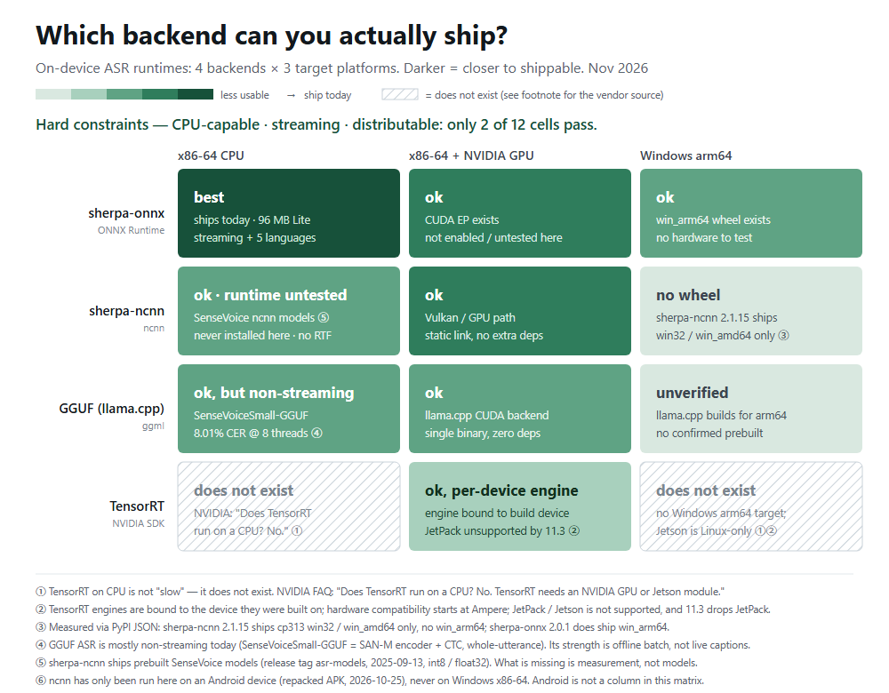

# Offlisten 录匣

**100% offline speech-to-text for meetings and lectures. No account, no cloud — pull the network cable and it keeps writing.**

> 中文版：[`README.md`](README.md)

Status: **works locally**. A 4,160-line Python engine (`engine/`) and a 12.5 KB browser extension (`extension/`). Two halves, one repository, decoupled by a written contract.

---

## Preface: why rebuild the wheel

Anyone who builds a wheel gets asked once: round wheels already exist.

On-device ASR is not short of wheels. What it is short of is people willing to **mark the dead ends** — everyone walks into one, says nothing, and the next person walks into it again.
So what this repository leaves behind is not "a rounder wheel", but a map: of 12 cells, only 2 satisfy *runs on CPU · streaming · shippable to strangers*. Every other cell says why it fails, and wherever an official document exists, the reason is quoted rather than felt.

Of those 2 cells this project uses 1 for the product and documents the other one anyway.
That is the proportion this small project keeps: **a product may give one answer; a survey has to give all of them.**



<sub>中文版：[`docs/bench/matrix-zh.png`](docs/bench/matrix-zh.png) · Per-cell reasons and evidence tiers: [`docs/bench/README.md`](docs/bench/README.md)</sub>

- How that map was built, and why it can be falsified → [`docs/paper.md`](docs/paper.md) (working paper)
- Which roads were tried and abandoned → [`docs/negative-results.md`](docs/negative-results.md) (9 entries, each with a verdict and an evidence path)

---

## What it does

- Turns **system audio** or **microphone** into text in real time (Chinese / English / Japanese / Korean / Cantonese)
- Files every session automatically: grouped by date, retitle, star, export
- Never touches the network: no upload, no login, no telemetry

## Four verifiable numbers

| Item | Measured | How |
|---|---|---|
| Extension size | **12.5 KB** | 8 files, **no build step, no npm dependencies**, produced by `pack.ps1` |
| Lite model tier | **96 MB** | English streaming 70 + Chinese 14M 25 + VAD 1 (int8 only) |
| Standard model tier | **229 MB** | SenseVoice int8, 5 languages, built-in punctuation |
| On-device self-check | **10 / 10** | Headless Edge loads the extension for real and drives it into the page |

> fp32 is never shipped: `model.onnx` is 895 MB and the `.tar.bz2` archives add up to roughly 2.2 GB — all development artifacts.

## Why "offline", not "local-first"

"Local-first" is a **policy** and can be changed to upload at any time. "Offline" is a **falsifiable promise** — ten seconds with the cable unplugged disproves it.
So only the latter is claimed, and only the latter is implemented: there is no upload path, and `host_permissions` declares nothing but `127.0.0.1` / `localhost`.

## Architecture: two independently runnable halves, one contract

```
Offlisten
├─ engine/       Python engine (4,160 lines) — ASR / capture / archive / SSE / export / subtitle overlay
│                pc_transcriber.py  web_live.py  live_core.py  win32_overlay.py  overlay.py
│                web_live/ (live · history · meeting pages)  tools/  acceptance/
├─ extension/    MV3 extension (8 files / 12.5 KB) — reads local transcripts, drives the engine
│                manifest.json  popup.html  popup.js  service_worker.js  icons/
├─ docs/         contract, distribution, ADRs, working paper, negative results, availability matrix
└─ tools/        packaging, contract check, release manifest, drift check
```

**The engine does not need the extension**: uninstall the extension and it still works, serving its own live page on `127.0.0.1`.
**The extension does not need the engine's code**: it only depends on the 4 endpoints fixed in `docs/contract.md`.

So the two halves can be released, uninstalled and reimplemented separately — the engine runs on Python + sherpa-onnx today and could be rewritten in anything tomorrow; as long as the contract holds, not a single line of the extension changes.

## Install (current stage: unpacked)

1. Start the local engine; the console prints a full URL containing a token.
2. Open `chrome://extensions` or `edge://extensions` and enable developer mode.
3. "Load unpacked" → select the **`extension/`** directory (the level containing `manifest.json`, not the repository root).
4. Click the extension icon, paste that URL, save and connect.

> Loading from the repository root fails: there is no `manifest.json` there. That is the cost of moving the extension into a subdirectory, and it is where it belongs.

## Self-checks (these run, they are not decoration)

```bash
node tools/contract_check.js          # 19 contract assertions against a running engine
python tools/check-links.py           # every relative link in every .md resolves, case-sensitively
python tools/name_cluster.py          # candidate-name clustering, typo-collision detection (stdlib only)
pwsh tools/pack.ps1                   # package the extension, verify every file manifest.json references
python tools/engine-drift.py          # engine/ vs working tree drift (exit 1 = drift)
python tools/build-dist.py --source <engine> --compress   # measure the real install size
```

`contract_check.js` reads the URL from `..\whisper\web_live.json` by default, or takes it explicitly:

```bash
node tools/contract_check.js --url "http://127.0.0.1:47813/?token=..."
node tools/contract_check.js --discovery D:\projects\whisper\web_live.json
```

## Explicit boundaries (what it refuses to do says more than what it does)

- **The extension cannot work alone**, and cannot run models: an MV3 service worker is not a long-lived process, has no `child_process`, and stores forbid bundling native executables.
- **The extension cannot capture the Zoom / Tencent Meeting desktop clients**: `tabCapture` only sees tabs. Capturing system-wide audio is the engine's job, via WASAPI loopback.
- **No Native Messaging**: the `nativeMessaging` permission is not requested and `connectNative` is unused (see the end of `docs/contract.md`).
- **No cloud fallback**: when accuracy is not enough, the answer is a bigger local model, not an upload.
- **No UI i18n**: the interface is Chinese only; extracting i18n would break the Chinese assertions in the on-device acceptance run for zero gain.

## Known limitations

- The extension cannot read the engine's discovery file, so **the token must be pasted by hand**; restarting the engine changes the token and it must be reconfigured.
- **The extension ID depends on the load path.** Measured on the same code: loading from the main project's `extension/` gives `ajgmcdhh…`, loading from this repository gives `hbfbckcfmnnakaekleoadicgnghofcij`. An unpacked ID is derived from the path; only a store install or a `key` in the manifest pins it. Native Messaging's `allowed_origins` must hard-code an ID, so an ID strategy is a prerequisite for NM.
- The Chinese name 录匣 is a coined word with zero search volume — a cost, not a benefit.
- The Lite tier's 14M Chinese model drops words on terminology, accents and far-field audio, and emits no punctuation.

## How the two copies relate to the working tree

Development happens in `D:\projects\whisper`; what is in this repository is a **release snapshot**. The two drift, so each direction has its own gate:

| Direction | Mechanism |
|---|---|
| `extension/` → `whisper\extension` | `tools/sync-to-main.ps1` overwrites one way by SHA256; **never edit the copy by hand** |
| `engine/` ← working tree | `tools/engine-drift.py` only reports; `--copy` overwrites back from the repository |

The extension resolves to the repository, the engine resolves to the working tree — the engine is running there with logs and uncommitted edits, and copying it over the repository would ship unverified changes. Neither direction merges automatically.

## Version

`extension/manifest.json`'s `version` is the only version number in this repository. Changing extension behaviour requires bumping it, otherwise store review cannot tell releases apart. Contract changes are logged in `docs/contract.md`.

## Docs

| File | Contents |
|---|---|
| `engine/README.md` | **Engine**: the two pipelines, module responsibilities, why the VAD threshold is not a constant, how to run it |
| `extension/` | The MV3 extension itself (8 files / 12.5 KB); load this directory |
| `docs/paper.md` | **Working paper**: the distributable-empty-set survey, with evidence tiers, validity threats, falsification conditions |
| `docs/negative-results.md` | **Negative results**: 9 abandoned or changed approaches, each with a verdict and evidence |
| `docs/bench/README.md` | The availability matrix: per-cell reasons, evidence tiers, decision tree, PR template (`matrix-zh` / `matrix-en`) |
| `docs/research-plan.md` | Long-term outlook: on-device ASR runtime availability map (dimensions, minimal experiment set, community form) |
| `docs/adr-001-runtime.md` | ADR: ncnn and ONNX coexisted, mainline fixed on ONNX (one reason struck through and annotated) |
| `docs/contract.md` | The API contract between extension and engine — the only interface agreement |
| `docs/distribution.md` | Engine distribution: **measured size accounting**, three routes, P0→P5, hard limits of main / Release / HF |
| `dist-manifest.json` | Release manifest: per-file `sha256` + size + files deliberately excluded and why |
| `tools/build-dist.py` | Generates the above; `--compress` measures the real download size |
| `docs/tech-notes.md` | Technical notes: size tiers, the ncnn trade-off, MSIX constraints |
| `docs/naming.md` | Naming and positioning: candidate verdicts, domain measurements, bilingual conventions |
| `docs/naming-tooling.md` | Naming toolchain: capability audit, division of labour, clustering results |
| `docs/publish.md` | Publishing checklist (GitHub + Release + naming verdicts) |
| `extension/icons/README.md` | Icon sources, palette, and how to re-rasterise per size |
| `CITATION.cff` | Citation metadata (GitHub's "Cite this repository" sidebar) |

## Contributing

See [`CONTRIBUTING.md`](CONTRIBUTING.md). Models are not in the repository; that file gives the exact download URLs and the byte sizes to verify against.

## License

MIT. Use it, change it, sell it, no attribution required (though it is appreciated).
