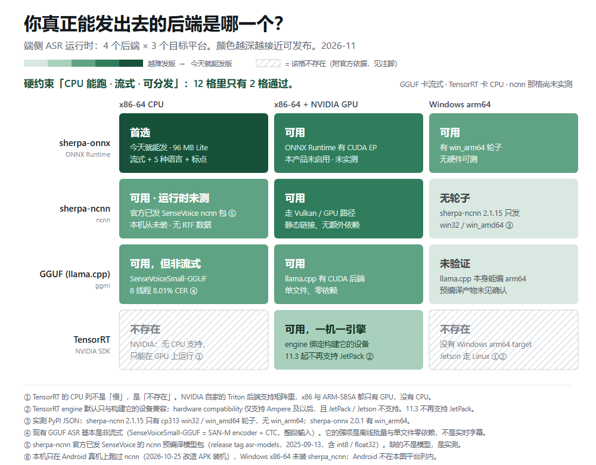

# 录匣 Offlisten

**100% 离线的会议 / 课堂转写。没有账号，没有云端，拔掉网线它还在写。**

> Offlisten — 100% offline speech-to-text for meetings and lectures.
> No account, no cloud, no telemetry. A 12.5 KB browser extension plus a local ASR engine.

当前状态：**本地可用**。扩展 `v0.2.1`，后端在同一台机器上的另一个仓库（纯 Python，无云依赖）。

---

## 前言：为什么重造轮子

造轮子的人总要被问一次：轮子已经有圆的了。

端侧这件事上，轮子确实不缺。缺的是有人愿意把**走过的死路标出来**——每个走过的人自己摔一次，摔完不说，下一个人再摔一次。
所以这个仓库最后留下的不是"我们的轮子更圆"，是那张地图：12 个格子里只有 2 格能同时满足「CPU 能跑 · 流式 · 可分发」，其余每一格都写清为什么不行，能引官方文档的就不靠感觉。

这 2 格我们只拿 1 格做产品，另 1 格照样写进文档。
这是这个小项目的分寸：**产品可以只给一个答案，测绘必须给出全部答案。**



<sub>English version: [`docs/bench/matrix-en.png`](docs/bench/matrix-en.png) · 逐格原因与证据分级见 [`docs/bench/README.md`](docs/bench/README.md)</sub>

- 想知道那张图怎么来的、凭什么能证伪 → [`docs/paper.md`](docs/paper.md)（工作稿）
- 想看哪些路我们试过并放弃了 → [`docs/negative-results.md`](docs/negative-results.md)（9 条，含放弃理由与证据）

---

## 它做什么

- 把**系统声音**或**麦克风**实时转成文字（中文 / 英文 / 日文 / 韩文 / 粤语）
- 每场会议自动成档：按日期分组，可改标题、标星、导出
- 过程不联网：不上传、不登录、不埋点

## 四个可验证的数字

| 项 | 实测值 | 怎么来的 |
|---|---|---|
| 扩展包体积 | **12.5 KB** | 8 个文件，**无构建、无 npm 依赖**，`pack.ps1` 产出 |
| Lite 模型档 | **96 MB** | 英文流式 70 + 中文 14M 25 + VAD 1（只发 int8） |
| 标准模型档 | **229 MB** | SenseVoice int8，5 语言，带标点 |
| 真机自检 | **10 / 10** | headless Edge 真实加载扩展并点到页面里 |

> 不发 fp32：`model.onnx` 895 MB 与几个 `.tar.bz2` 共约 2.2 GB，都是开发期产物。

## 为什么说"离线"而不是"本地优先"

"本地优先"是**策略**，可以随时改成上传；"离线"是**可验证的承诺**——断网演示十秒就能证伪。
所以对外只说后者，代码里也只做后者：没有上传路径，`host_permissions` 只声明 `127.0.0.1` / `localhost`。

## 架构：两个仓库，一条契约

```
录匣 Offlisten
├─ 浏览器扩展（本仓库）      MV3，只做两件事：读本机转写、遥控本机引擎
│     └─ 唯一发请求的地方是 service worker（popup 不直接 fetch）
└─ 本地引擎（另一个仓库）     ASR / 会议存档 / SSE / 导出，纯 Python
```

两者**不是代码耦合，是契约耦合**：`docs/contract.md` 钉死 `/health`、`/transcript.json`、
`/api/control/state|action` 的字段、错误码与鉴权方式。后端可随时改实现，但改端点必须同步改契约。

## 安装（当前阶段：unpacked）

1. 启动本地后端，控制台会打印一行带 token 的完整地址。
2. 打开 `chrome://extensions` 或 `edge://extensions`，开启「开发者模式」。
3. 「加载已解压的扩展程序」→ 选本仓库根目录（含 `manifest.json` 那一层）。
4. 点扩展图标，把那行完整地址粘进输入框 → 「保存并连接」。

## 自检（能跑，不是摆设）

```bash
node scripts/contract_check.js        # 对运行中的后端验 19 项契约
python scripts/name_cluster.py        # 候选名聚类与"打错就串"检测（纯标准库、离线）
pwsh scripts/pack.ps1                 # 打包，并校验 manifest 引用的文件真实存在
```

`contract_check.js` 默认从 `..\whisper\web_live.json` 取地址，也可显式指定：

```bash
node scripts/contract_check.js --url "http://127.0.0.1:47813/?token=..."
node scripts/contract_check.js --discovery D:\projects\whisper\web_live.json
```

## 明确的边界（不做的比做的更说明问题）

- **扩展不能独立工作**，也不能跑模型：MV3 service worker 不是常驻进程，没有 `child_process`，商店也禁止包内捆绑原生可执行文件。
- **扩展抓不到 Zoom / 腾讯会议的桌面客户端**：`tabCapture` 只能抓标签页。抓全系统声音靠后端走 WASAPI loopback。
- **没走 Native Messaging**：`nativeMessaging` 权限未申请，`connectNative` 未使用（见 `docs/contract.md` 末尾）。
- **不做云端兜底**：识别质量不够时，选择是换更大的本地模型，而不是上传。
- **不做界面 i18n**：当前全中文；抽 i18n 会打断真机验收里的中文断言，收益为零。

## 已知限制

- 扩展读不到后端的发现文件，**token 只能手粘**；后端重启换 token 要重配。
- **扩展 ID 随加载路径变化**。实测同一份代码：从主项目 `extension/` 加载得到 `ajgmcdhh…`，
  从本仓库加载得到 `hbfbckcfmnnakaekleoadicgnghofcij`。unpacked 的 ID 由路径派生，
  只有商店安装或 manifest 加 `key` 才固定。Native Messaging 的 `allowed_origins` 必须写死 ID，
  所以要做 NM，得先定 ID 策略。
- 中文名 `录匣` 是造词，零搜索量（这是代价，不是红利）。
- Lite 档的 14M 中文模型对术语、口音、远场会掉字，且不出标点。

## 两处代码，单向同步

本仓库是扩展的事实源；主项目里的 `extension/` 只是内测加载副本，由 `scripts/sync-to-main.ps1`
按 SHA256 覆盖过去，**禁止反向手改**（改了下次同步就被冲掉）。

## 版本

`manifest.json` 的 `version` 是本仓库唯一版本号。改动扩展行为必须同时更新它，
否则商店审核与「已加载版本」无法区分。契约变更见 `docs/contract.md` 的变更记录。

## 文档

| 文件 | 内容 |
|---|---|
| `docs/paper.md` | **工作稿**：可分发空集测绘，含证据分级、效度威胁、可证伪条件 |
| `docs/negative-results.md` | **负结果册**：9 条放弃/改法的路，每条附判定与证据路径 |
| `docs/bench/README.md` | 可用性矩阵成品：12 格逐格原因、证据分级、决策树、PR 模板（图见 `matrix-zh` / `matrix-en` 两套） |
| `docs/research-plan.md` | 长期展望：端侧 ASR 运行时可用性地图（维度定义、最小实验集、社区形态） |
| `docs/adr-001-runtime.md` | ADR：ncnn 与 ONNX 曾并存，主线定为 ONNX（含取舍依据，部分理由已作废并标注） |
| `docs/contract.md` | 扩展与后端之间的 API 契约（唯一接口约定） |
| `docs/distribution.md` | 后端分发方案：**实测体积账**、三条路线、P0→P5 |
| `dist-manifest.json` | 发行清单：逐文件 `sha256` + 体积 + 被故意排除的文件及原因 |
| `scripts/build-dist.py` | 生成上表的脚本，`--compress` 可实测安装包下载体积 |
| `docs/tech-notes.md` | 技术素材与交付路径：体积档、ncnn 权衡、MSIX 约束 |
| `docs/naming.md` | 命名与定位：候选判定、域名实测、双语口径 |
| `docs/naming-tooling.md` | 命名工具链：能力核查、分工边界、聚类实测 |
| `docs/publish.md` | 发布占位清单（GitHub + Release + 命名判定） |
| `brand/README.md` | 图标设计过程（四候选、逐尺寸光栅化对比） |
| `CITATION.cff` | 引用信息（GitHub 侧栏会显示「Cite this repository」） |

## License

MIT。随便用、随便改、随便商用，不要求署名（署名更好）。
