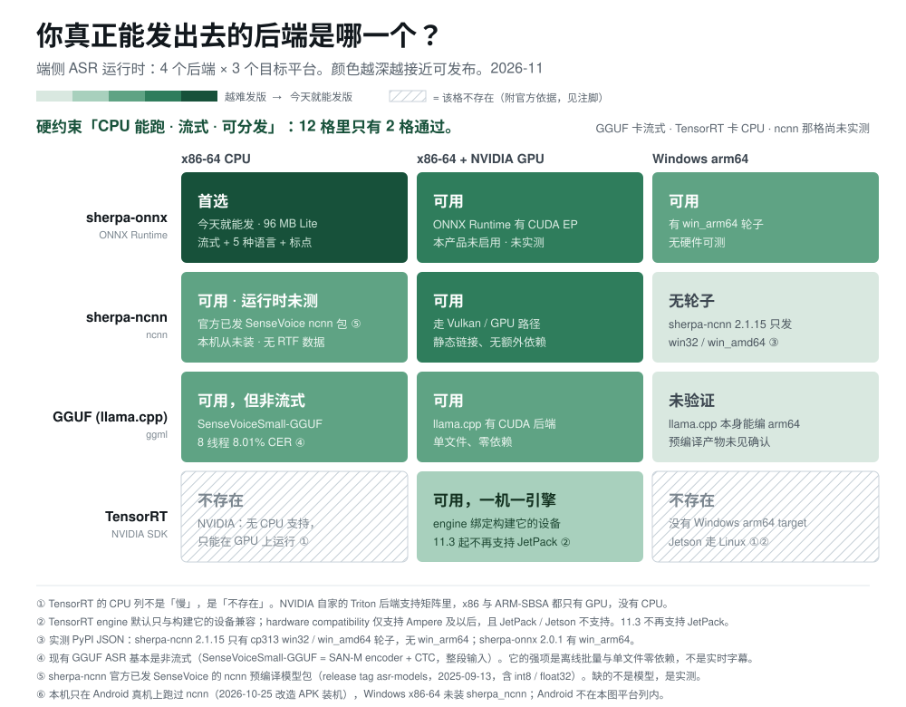
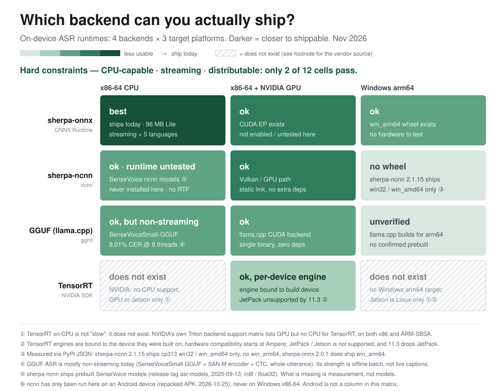

# 端侧 ASR 运行时可用性矩阵

| 中文版 | English |
|---|---|
| [](matrix-zh.png) | [](matrix-en.png) |

> **一句话结论：三条硬约束「CPU 能跑 · 流式 · 可分发」下，12 格里只有 2 格通过（sherpa-onnx 与 sherpa-ncnn），
> 其中只有 1 格有本机实测。GGUF 卡在流式，TensorRT 卡在 CPU。**

这张图不回答"哪个最快"，回答**哪些格子根本不存在，以及为什么**。
端侧选型最常见的失败不是选了个慢的，是选中了一个**原理上就装不到用户机器上**的组合。

## 怎么读

- **颜色越深越可用**：最深 = 今天就能发版；中深 = 能跑但没实测；浅 = 有明确限制；最浅 = 缺轮子或未验证。
- **斜纹 = 该格不存在**，不是"慢"，是"没有这个选项"。每个斜纹都附官方依据，不给猜测。
- 图上只放结论，原因在下面逐格写清。

## 证据分级（12 格逐格交代依据从哪来）

一张选型表最该被追问的是"你凭什么这么写"。所以每格标一级，**级别决定它能被怎样引用**：

| 级别 | 含义 | 可被引用为 | 格数 | 哪些格 |
|---|---|---|---|---|
| **L1 官方文档 / 包矩阵** | 可当场复核，不依赖本机 | 结论 | 5 | TRT ×3（FAQ + 支持矩阵）、ncnn arm64（PyPI 文件名）、GGUF x86-CPU（官方模型卡含 CER） |
| **L2 运行时实测** | 在本机跑起来并量过 | 结论（限本机配置） | 1 | onnx x86-CPU（SenseVoice int8，产品主用） |
| **L2′ 只测模型侧** | 模型取证做过，运行时没跑 | 仅"模型在"，不是"能跑" | 1 | ncnn x86-CPU——见下节 |
| **L3 推断 / 未验证** | 写明推断链，不冒充实测 | 仅"值得试" | 5 | onnx x86+GPU、onnx arm64、ncnn x86+GPU、GGUF x86+GPU、GGUF arm64 |

L2′ 单列的理由：**模型取证**（文件在、结构对得上、md5 一致）回答"这个模型是不是它宣称的那个"；
**运行时实测**（跑起来、量出 RTF 与 CER）回答"它在这台机器上多快"。后者才是颜色深浅的依据，前者做了不等于后者做了。

**L3 的 5 格不许被引用成结论**——它们是"值得试"，不是"测过"。

## ncnn 那一格测过什么

**模型侧（L2′）**

- `official_model/` 135 MB、`apk_models/` 135 MB 在盘上，逐文件量过；
- vendor 模型 `xb-zh-en-v3` 与官方 `sherpa-ncnn-streaming-zipformer-bilingual-zh-en-2023-02-13` 的 `param` / `tokens` **md5 完全一致**（纯改名未微调）；
- `SherpaMetaData` 逐项一致：层数 `2,4,3,2,4`、encoder_dim `384×5`、attention_dim `192×5`、下采样 `1,2,4,8,2`、CNN kernel `31×5`；
- 同构替换做过：换 `zipformer-libri-giga-70M-2023-04-04`（decoder/joiner 仅 vocab 6254→500）。

**运行时（Android 真机，不在本图平台列内）**

- 2026-10-25：`apktool` 拆包 + `uber-apk-signer` 重签后 **APK 卸载原版即安装成功**，跑的是 `arm64-v8a` + Vulkan。
- 也就是说 ncnn 推理确实跑起来过，但它落在图的平台列之外。

**运行时（Windows x86-64，即本图该格）**

- 本机 `.venv` 与系统 Python **均无 `sherpa_ncnn`**；全仓 `.py` **无 `import sherpa_ncnn`**；
- `ASR升级评估报告.md` 的 `RTF 0.3~0.6` 在该文件里自标「⚠️ 基于公开 benchmark 的**估算值**」，不能当实测用。

→ 该格因此记「ok · 运行时未测」：模型在、轮子在、路是通的，但这台机器上没开过车。

## 覆盖范围：缺一列 Android arm64

图的平台列是按"用户要装到哪里"选的（x86-64 / x86+GPU / Windows arm64），而实际跑过的设备里有一台 Android 手机。
两者不重合，于是**唯一有 ncnn 真机数据的平台不在图内**。补列之前，Android 的体验不能被当作图上的数据引用。

## 逐格说明（12 条）

### sherpa-onnx（ONNX Runtime）

| 平台 | 判定 | 原因 |
|---|---|---|
| x86-64 CPU | **best** | 本项目主用。SenseVoice int8 229 MB 或 Lite 96 MB（英文流式 70 + 中文 14M 25 + VAD 1），流式 + 5 语言 + 标点。 |
| x86 + NVIDIA GPU | ok | ONNX Runtime 有 CUDA EP，但本产品**没启用**——会议场景 1–2 小时音频用 CPU 已非实时压力，开 GPU 会吃显存、增加分发复杂度，收益不抵成本。 |
| Windows arm64 | ok | `sherpa-onnx 2.0.1` 有 cp313 `win_arm64` 轮子（PyPI 实测）。**无硬件，未实测**。 |

### sherpa-ncnn（ncnn）

| 平台 | 判定 | 原因 |
|---|---|---|
| x86-64 CPU | ok · **未实测** | 官方已发 SenseVoice 的 ncnn 模型包：release tag `asr-models`（2025-09-13）下有 `sherpa-ncnn-sense-voice-zh-en-ja-ko-yue-2025-09-09`（含 int8 / float32，另有 2024-07-17 版）。文档有 SenseVoice 专章且含「Real-time speech recognition from a microphone」。**缺的不是模型，是本机的 RTF / CER 实测**；SenseVoice 本身是整段 CTC 编码器，chunk 化后的真实延迟待测。 |
| x86 + NVIDIA GPU | ok | 走 Vulkan / GPU 路径，静态链接、无第三方推理框架依赖——这是 ncnn 唯一明显的结构性优势。 |
| Windows arm64 | **no wheel** | PyPI 实测：`sherpa-ncnn 2.1.15` 只有 cp313 `win32` / `win_amd64`，**没有 `win_arm64`**。 |

### GGUF（llama.cpp / FunASR-llamacpp）

| 平台 | 判定 | 原因 |
|---|---|---|
| x86-64 CPU | ok，但**非流式** | `FunAudioLLM/SenseVoiceSmall-GGUF`（q8 ≈235 MB）8 线程 **8.01% CER**（184 条普通话；同基准 whisper.cpp 为 22–31%）。但现有 GGUF ASR 基本是**整段输入**（SAN-M encoder + CTC），不适合实时字幕。 |
| x86 + NVIDIA GPU | ok | llama.cpp 有 CUDA 后端；单文件二进制、零依赖，是目前**分发体验最好**的一档。 |
| Windows arm64 | unverified | llama.cpp 本身能编 arm64，但 FunASR 那条链的预编译 arm64 二进制**未见确认**。标"未验证"，不标"可用"。 |

### TensorRT（NVIDIA SDK）

| 平台 | 判定 | 原因 |
|---|---|---|
| x86-64 CPU | **does not exist** | NVIDIA 官方 FAQ 原文：*"Does TensorRT run on a CPU? **No.** TensorRT needs an NVIDIA GPU or Jetson module."* Triton 的支持矩阵同样显示 x86 与 ARM-SBSA 都是 `GPU ✅ / CPU ❌`。 |
| x86 + NVIDIA GPU | ok，但**一机一引擎** | engine 默认只与构建它的设备类型兼容；hardware compatibility 仅支持 Ampere 及以后，且 **JetPack / Jetson 不支持**；TensorRT 11.3 不再支持 JetPack。→ 在"给未知用户的安装包"场景里几乎不可用。 |
| Windows arm64 | **does not exist** | TensorRT 没有 Windows arm64 target；Jetson 走 Linux / JetPack。 |

## 这张图**故意不测**什么

诚实标注"不测"，比编一个估算值有价值：

| 项 | 为什么不做 |
|---|---|
| **功耗** | Windows 读不到 RAPL，物理功耗要外接功率计。代理指标（HWiNFO package power、`powercfg` 电池放电、CPU 时间×占用）噪声大且跨机型不可比，**放进图里会让人误以为测过**。宁可不放。 |
| CPU 型号横评 | 换一台机器结论就变，那是硬件评测，不是运行时选型。 |
| WER / CER 跨数据集比较 | 各模型用的测试集不同，横向比 CER 是伪对比。只报"同数据集内的自测值"并注明来源。 |
| 全部 192 格 | 4 运行时 × 4 线程 × 3 平台 × 4 模型。个人做不完，且大部分格子不改变结论。**只填能改变结论的格子。** |

## 选型决策树

```
要给「未知用户的 Windows 桌面机」装？
├─ 要实时字幕（流式） → sherpa-onnx + CPU          ← 唯一同时满足的路径
├─ 只要离线批量转写     → GGUF（单文件、零依赖）
└─ 要 Windows on ARM   → sherpa-onnx（有 arm64 轮子）

设备固定、有 NVIDIA 卡、追极致吞吐？
└─ TensorRT（但绑定这一台机器，不能分发）

要静态链接、不要任何运行时依赖？
└─ ncnn（但接受模型天花板：没有更强的双语模型）
```

## 数据来源与可复现

- **官方依据**：NVIDIA TensorRT FAQ、Triton Backend-Platform Support Matrix、TensorRT 11.3 Release Notes（JetPack 支持状态）。
- **包矩阵实测**：PyPI JSON API 查 `sherpa-ncnn` / `sherpa-onnx` 的 wheel 文件名（`cp313-win*`），命令见 `docs/tech-notes.md` §1.4。
- **ncnn 侧 SenseVoice**：`k2-fsa/sherpa-ncnn` release tag `asr-models`（2025-09-13）的 6 个 asset（2024-07-17 / 2025-09-09 × 默认/int8/float32）；文档 `k2-fsa.github.io/sherpa/ncnn/sense-voice/` 含 SenseVoice 专章。
- **GGUF 数据**：`FunAudioLLM/SenseVoiceSmall-GGUF` 官方模型卡（q8/f16 体积、8 线程 8.01% CER）。
- **本项目实测**：`sherpa_onnx 2.0.0` + `onnxruntime 1.31.0`；模型体积由 `du` / `find -printf` 逐文件量出。

## 想补一格？（欢迎 PR）

一格有效数据的模板：

```
运行时 / 版本：      例如 sherpa-ncnn 2.1.15
模型 + 量化：        zipformer-zh-14M int8
平台 + CPU：         Windows 11 x64 / i7-12700H
线程：              4
音频：              <文件名> (sha256: ...) 时长 15.3s
结果：              RTF 0.046 / 峰值内存 XXX MB / 包体积 XX MB
命令行：            （完整可复制）
```

**只有"不存在"的格子可以不带数据**——但必须附官方依据链接。这是本图唯一接受的"没有数据"。

## 重新生成（改图不用重画）

两张图同源同布局，只有文案语言不同。改 `matrix-zh.svg` / `matrix-en.svg` 后各自重出：

```bash
cd docs/bench

# 必须用「绝对 Windows 路径」拼 file:// URL。
# Git Bash 下 $PWD 是 /d/projects/...，拼出来是 file:////d/... ，Edge 会报 ERR_FILE_NOT_FOUND 并静默不截图。
W='D:/projects/whisper-ext/docs/bench'
EDGE="/c/Program Files (x86)/Microsoft/Edge/Application/msedge.exe"

for L in zh en; do
  printf '<!doctype html><meta charset="utf-8"><style>html,body{margin:0;padding:0;overflow:hidden;background:#fff}img{display:block;width:1000px;height:780px}</style>' "$L" > _r.html
  "$EDGE" --headless=new --disable-gpu --hide-scrollbars \
    --default-background-color=ffffffff --window-size=1000,780 \
    --screenshot="$W/matrix-$L.png" "file:///$W/_r.html"
  sleep 4   # msedge 先返回、后写文件，不等会读到上一版

  printf '<!doctype html><meta charset="utf-8"><style>@page{size:1000px 780px;margin:0}html,body{margin:0}img{display:block;width:1000px;height:780px}</style>' "$L" > _p.html
  "$EDGE" --headless=new --disable-gpu --no-pdf-header-footer \
    --print-to-pdf="$W/matrix-$L.pdf" "file:///$W/_p.html"
  sleep 4
done
rm -f _r.html _p.html
```

`_r.html` / `_p.html` 是临时文件，不提交。

**两个已验证的坑**：
1. `file:///$PWD/...` 不行——URL 会变成 `file:////d/projects/...`，Edge 直接 `ERR_FILE_NOT_FOUND`，而且**退出码是 0**，看起来像成功；
2. 不加 `sleep` 会在文件还没写完时就去 `ls`，看到的还是旧图的体积与 md5。**判断是否真的重出，比 md5，别信时间戳。**

## 图与产物的对应

| 文件 | 语言 | 用途 |
|---|---|---|
| `matrix-zh.svg` / `.png` / `.pdf` | 中文 | 哔哩哔哩、小红书、知乎、中文 README |
| `matrix-en.svg` / `.png` / `.pdf` | English | X、Hugging Face、英文 README |
