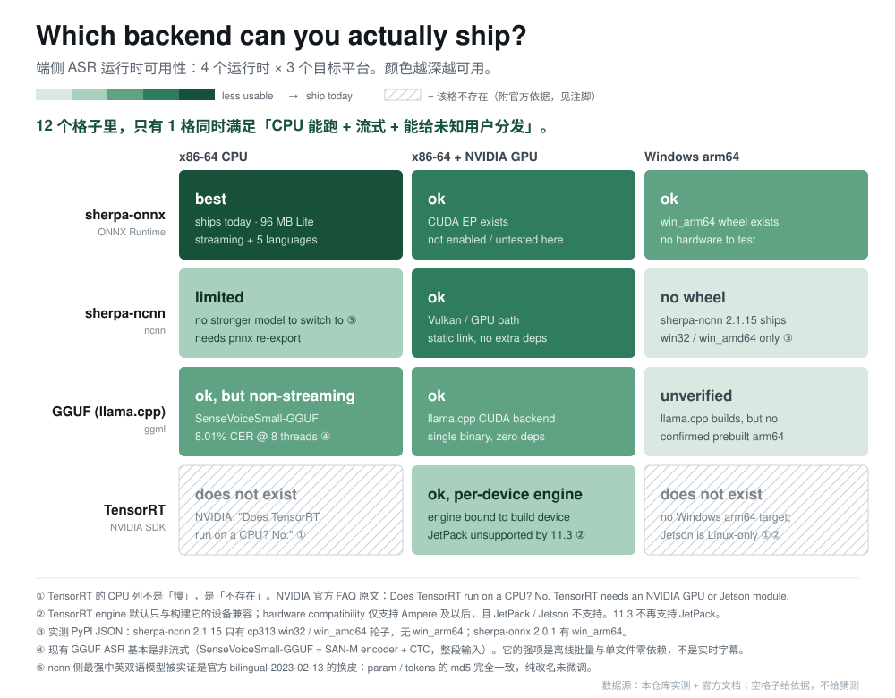

# 端侧 ASR 运行时可用性矩阵



> **一句话结论：4 个运行时 × 3 个目标平台 = 12 个格子里，只有 1 格同时满足「CPU 能跑 + 流式 + 能给未知用户分发」。**

这张图的目的不是告诉你"哪个最快"，是告诉你**哪些格子根本不存在，以及为什么**。
大多数人在端侧选型上重复踩的坑，不是性能不够，是选中了一个**原理上就装不到用户机器上**的组合。

## 怎么读

- **颜色越深越可用**：最深 = 今天就能发版；中深 = 能跑但没实测；浅 = 有明确限制；最浅 = 缺轮子或未验证。
- **斜纹 = 该格不存在**，不是"慢"，是"没有这个选项"。每个斜纹都附官方依据，不给猜测。
- 图上只放结论，原因在下面逐格写清。

## 逐格说明（12 条）

### sherpa-onnx（ONNX Runtime）

| 平台 | 判定 | 原因 |
|---|---|---|
| x86-64 CPU | **best** | 本项目主用。SenseVoice int8 229 MB 或 Lite 96 MB（英文流式 70 + 中文 14M 25 + VAD 1），流式 + 5 语言 + 标点。 |
| x86 + NVIDIA GPU | ok | ONNX Runtime 有 CUDA EP，但本产品**没启用**——会议场景 1–2 小时音频用 CPU 已非实时压力，开 GPU 会吃显存、增加分发复杂度，收益不抵成本。 |
| Windows arm64 | ok | `sherpa-onnx 2.0.1` 有 cp313 `win_arm64` 轮子（PyPI 实测）。**无硬件，未实测**。 |

### sherpa-ncnn（ncnn）

| 平台 | 判定 | 原因 |
|---|---|---|
| x86-64 CPU | limited | 能跑，但**没有更强的模型可换**：ncnn 侧最强中英双语模型被实证是官方 `bilingual-2023-02-13` 的换皮，`param`/`tokens` 的 md5 完全一致（纯改名未微调）。换过去等于降级，还得 pnnx 重导出。 |
| x86 + NVIDIA GPU | ok | 走 Vulkan / GPU 路径，静态链接、无第三方推理框架依赖——这是 ncnn 唯一明显的结构性优势。 |
| Windows arm64 | **no wheel** | PyPI 实测：`sherpa-ncnn 2.1.15` 只有 cp313 `win32` / `win_amd64`，**没有 `win_arm64`**。 |

### GGUF（llama.cpp / FunASR-llamacpp）

| 平台 | 判定 | 原因 |
|---|---|---|
| x86-64 CPU | ok，但**非流式** | `FunAudioLLM/SenseVoiceSmall-GGUF`（q8 ≈235 MB）8 线程 **8.01% CER**（184 条普通话；同基准 whisper.cpp 为 22–31%）。但现有 GGUF ASR 基本是**整段输入**（SAN-M encoder + CTC），不适合实时字幕。 |
| x86 + NVIDIA GPU | ok | llama.cpp 有 CUDA 后端；单文件二进制、零依赖，是目前**分发体验最好**的一档。 |
| Windows arm64 | unverified | llama.cpp 本身能编 arm64，但 FunASR 那条链的预编译 arm64 二进制**未见确认**。标"未验证"，不标"可用"。 |

### TensorRT（NVIDIA SDK）

| 平台 | 判定 | 原因 |
|---|---|---|
| x86-64 CPU | **does not exist** | NVIDIA 官方 FAQ 原文：*"Does TensorRT run on a CPU? **No.** TensorRT needs an NVIDIA GPU or Jetson module."* Triton 的支持矩阵同样显示 x86 与 ARM-SBSA 都是 `GPU ✅ / CPU ❌`。 |
| x86 + NVIDIA GPU | ok，但**一机一引擎** | engine 默认只与构建它的设备类型兼容；hardware compatibility 仅支持 Ampere 及以后，且 **JetPack / Jetson 不支持**；TensorRT 11.3 不再支持 JetPack。→ 在"给未知用户的安装包"场景里几乎不可用。 |
| Windows arm64 | **does not exist** | TensorRT 没有 Windows arm64 target；Jetson 走 Linux / JetPack。 |

## 这张图**故意不测**什么

诚实标注"不测"，比编一个估算值有价值：

| 项 | 为什么不做 |
|---|---|
| **功耗** | Windows 读不到 RAPL，物理功耗要外接功率计。代理指标（HWiNFO package power、`powercfg` 电池放电、CPU 时间×占用）噪声大且跨机型不可比，**放进图里会让人误以为测过**。宁可不放。 |
| CPU 型号横评 | 换一台机器结论就变，那是硬件评测，不是运行时选型。 |
| WER / CER 跨数据集比较 | 各模型用的测试集不同，横向比 CER 是伪对比。只报"同数据集内的自测值"并注明来源。 |
| 全部 192 格 | 4 运行时 × 4 线程 × 3 平台 × 4 模型。个人做不完，且大部分格子不改变结论。**只填能改变结论的格子。** |

## 选型决策树

```
要给「未知用户的 Windows 桌面机」装？
├─ 要实时字幕（流式） → sherpa-onnx + CPU          ← 唯一同时满足的路径
├─ 只要离线批量转写     → GGUF（单文件、零依赖）
└─ 要 Windows on ARM   → sherpa-onnx（有 arm64 轮子）

设备固定、有 NVIDIA 卡、追极致吞吐？
└─ TensorRT（但绑定这一台机器，不能分发）

要静态链接、不要任何运行时依赖？
└─ ncnn（但接受模型天花板：没有更强的双语模型）
```

## 数据来源与可复现

- **官方依据**：NVIDIA TensorRT FAQ、Triton Backend-Platform Support Matrix、TensorRT 11.3 Release Notes（JetPack 支持状态）。
- **包矩阵实测**：PyPI JSON API 查 `sherpa-ncnn` / `sherpa-onnx` 的 wheel 文件名（`cp313-win*`），命令见 `docs/tech-notes.md` §1.4。
- **GGUF 数据**：`FunAudioLLM/SenseVoiceSmall-GGUF` 官方模型卡（q8/f16 体积、8 线程 8.01% CER）。
- **本项目实测**：`sherpa_onnx 2.0.0` + `onnxruntime 1.31.0`；模型体积由 `du` / `find -printf` 逐文件量出。

## 想补一格？（欢迎 PR）

一格有效数据的模板：

```
运行时 / 版本：      例如 sherpa-ncnn 2.1.15
模型 + 量化：        zipformer-zh-14M int8
平台 + CPU：         Windows 11 x64 / i7-12700H
线程：              4
音频：              <文件名> (sha256: ...) 时长 15.3s
结果：              RTF 0.046 / 峰值内存 XXX MB / 包体积 XX MB
命令行：            （完整可复制）
```

**只有"不存在"的格子可以不带数据**——但必须附官方依据链接。这是本图唯一接受的"没有数据"。

## 重新生成（改图不用重画）

只改 `matrix.svg`，然后重新出 PNG / PDF：

```bash
cd docs/bench
printf '<!doctype html><meta charset="utf-8"><style>html,body{margin:0;padding:0;overflow:hidden;background:#fff}img{display:block;width:1000px;height:780px}</style>' > _r.html
"/c/Program Files (x86)/Microsoft/Edge/Application/msedge.exe" --headless=new --disable-gpu \
  --hide-scrollbars --default-background-color=ffffffff --window-size=1000,780 \
  --screenshot="$PWD/matrix.png" "file:///$PWD/_r.html"

printf '<!doctype html><meta charset="utf-8"><style>@page{size:1000px 780px;margin:0}html,body{margin:0}img{display:block;width:1000px;height:780px}</style>' > _p.html
"/c/Program Files (x86)/Microsoft/Edge/Application/msedge.exe" --headless=new --disable-gpu \
  --no-pdf-header-footer --print-to-pdf="$PWD/matrix.pdf" "file:///$PWD/_p.html"
rm -f _r.html _p.html
```

`_r.html` / `_p.html` 是临时文件，不提交。

## 版本

- `2026-11-12` 初版：4×3 矩阵，12 格，5 条注脚。
- 图源是 `matrix.svg`（可编辑），`matrix.png` 用于社交平台，`matrix.pdf` 用于打印/引用。
